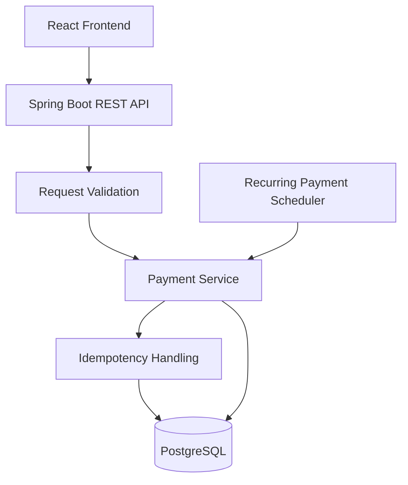
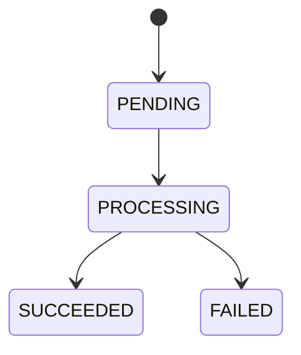
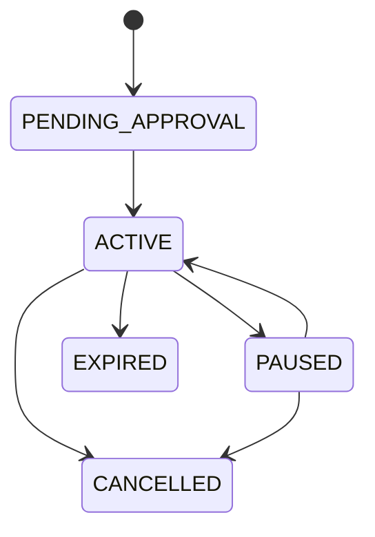
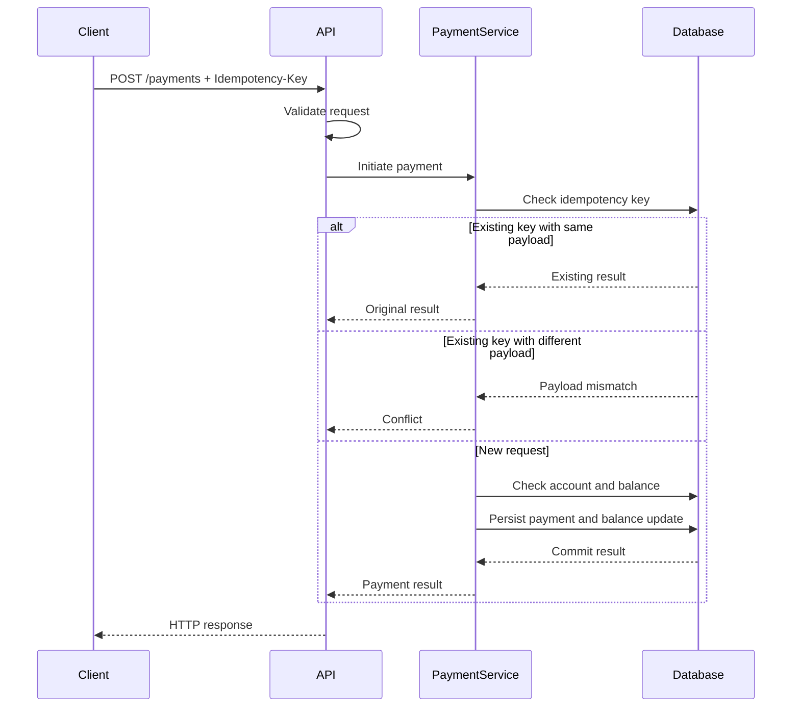

# PayFlow — System Architecture

**Project:** PayFlow  
**Version:** 1.0  
**Status:** Initial Design  
**Backend:** Java 21, Spring Boot  
**Database:** PostgreSQL  
**Architecture Style:** Modular Monolith

---

## 1. Overview

PayFlow is a distributed payment processing system designed to demonstrate backend engineering concepts such as transaction management, idempotency, concurrency control, recurring payments, data consistency, and fault handling.

The initial implementation will simulate payment processing within the PayFlow platform. No external banking network or payment gateway is involved.

Users can create internal accounts, initiate payments, and configure recurring payment mandates.

The system will initially be implemented as a **modular monolith**, keeping the codebase maintainable while avoiding the operational complexity of microservices.

## 2. Goals and Scope

### 2.1 Initial Goals

- Manage users and their internal accounts.
- Maintain account balances.
- Support one-time payments.
- Support recurring payment mandates.
- Prevent duplicate payment execution through idempotency.
- Maintain reliable transaction and balance updates.
- Preserve payment history and status.
- Provide REST APIs for frontend integration.

### 2.2 Out of Scope for Initial Version

- Real bank integrations.
- External payment gateway integrations.
- Real money transfers.
- Multi-currency exchange.
- Microservices deployment.
- Advanced fraud detection.
- Production-grade distributed scheduling.

These capabilities may be considered in later iterations.

## 3. High-Level Architecture

The initial system follows a layered modular monolith architecture.



### Components

| Component | Responsibility |
|---|---|
| React Frontend | User interface and API interaction |
| REST API | Exposes application endpoints |
| Validation Layer | Validates incoming requests |
| Payment Service | Coordinates payment execution |
| Idempotency Handling | Prevents duplicate processing |
| PostgreSQL | Persistent storage |
| Recurring Scheduler | Triggers scheduled mandate payments |

The scheduler will be introduced in a later implementation phase.

## 4. Core Domain Entities

### 4.1 User

Represents a registered PayFlow user.

Important fields:

- `id` — UUID primary key
- `email` — Unique normalized email
- `password_hash` — Securely stored password hash
- `created_at` — Account creation timestamp

### 4.2 Account

Represents an internal PayFlow account owned by a user.

Important fields:

- `id` — UUID primary key
- `user_id` — Reference to the owner
- `currency` — Account currency
- `balance` — Current available balance
- `status` — Account status
- `created_at` — Creation timestamp

The initial implementation will use internal simulated balances.

### 4.3 Mandate

Represents an instruction to execute a fixed recurring payment.

Important fields:

- `id` — UUID primary key
- `account_id` — Associated account
- `amount` — Fixed recurring amount
- `currency` — Payment currency
- `day_of_month` — Scheduled execution day
- `timezone` — Mandate scheduling timezone
- `next_run_at` — Next scheduled execution
- `status` — Current mandate status

A mandate represents the recurring instruction, not an individual payment.

### 4.4 Transaction

Represents an individual payment attempt.

Important fields:

- `id` — UUID primary key
- `account_id` — Source account
- `mandate_id` — Optional reference to the originating mandate
- `amount` — Transaction amount
- `currency` — Transaction currency
- `type` — Payment type
- `status` — Transaction status
- `scheduled_for` — Optional scheduled occurrence timestamp

Each recurring execution creates a separate transaction associated with the same mandate.

### 4.5 Idempotency Record

Stores information required to recognize and safely replay previously processed requests.

Important fields:

- `id` — UUID primary key
- `idempotency_key` — Client-provided key
- `request_hash` — Fingerprint of the original request
- `transaction_id` — Associated transaction
- `created_at` — Record creation timestamp

The key must be unique within its defined scope.

### 4.6 Ledger Entry

Represents an immutable financial movement associated with a transaction.

Important fields:

- `id` — UUID primary key
- `transaction_id` — Associated transaction
- `account_id` — Affected account
- `amount` — Ledger movement amount
- `created_at` — Entry creation timestamp

Ledger entries will be introduced as part of the financial consistency implementation.

## 5. Payment Lifecycle

A payment follows this initial state machine:



### State Descriptions

| State | Meaning |
|---|---|
| PENDING | Payment has been accepted for processing |
| PROCESSING | Payment execution is in progress |
| SUCCEEDED | Payment completed successfully |
| FAILED | Payment execution failed |

`SUCCEEDED` and `FAILED` are terminal states in the initial implementation.

## 6. Mandate Lifecycle

A recurring mandate has its own lifecycle, independent of individual transactions.



### Mandate Rules

- A mandate has a fixed monthly amount.
- A mandate is associated with an internal account.
- Pausing a mandate prevents future scheduled executions.
- Resuming a mandate allows future executions.
- Cancelling a mandate prevents future executions permanently.
- Failed payment attempts do not automatically cancel a mandate.
- Existing transaction history is preserved after cancellation.
- If the scheduled day does not exist in a month, the last calendar day of that month is used.

For the initial implementation, mandate creation will activate the mandate directly. The approval state is retained in the domain model for future extension.

## 7. One-Time Payment Flow

The initial one-time payment flow:

1. Client sends a payment request with an idempotency key.
2. API validates the request.
3. Payment service checks the idempotency record.
4. If the key has already been used:
    - Same request payload: return the original result.
    - Different request payload: return HTTP 409.
5. Payment service checks account ownership and status.
6. Payment service checks available balance.
7. Payment is processed.
8. Account balance and transaction outcome are persisted atomically.
9. The API returns the payment result.

### Sequence Diagram



## 8. Recurring Payment Flow

Recurring payments are executed based on active mandates.

1. Scheduler identifies mandates that are due.
2. Scheduler determines the scheduled occurrence.
3. A separate transaction is created for that occurrence.
4. The transaction is associated with the originating mandate.
5. Payment processing uses the same payment service as one-time payments.
6. The next execution time is calculated.
7. Mandate and transaction state are persisted consistently.

The scheduler will not implement separate payment business logic. It will reuse the payment service.

A uniqueness constraint on `(mandate_id, scheduled_for)` will prevent duplicate transaction creation for the same scheduled occurrence.

## 9. Financial Consistency and Invariants

Financial correctness is a core requirement.

The following invariants must be maintained:

1. Payment amounts must be positive.
2. Account balances must never become negative in the initial model.
3. Money must use `BigDecimal` in Java.
4. PostgreSQL must use `NUMERIC` for monetary values.
5. Debit and associated ledger movements must be committed atomically.
6. Ledger entries must be immutable.
7. A payment request must not execute more than once for the same idempotency scope and key.
8. The same idempotency key with a different payload must be rejected.
9. A scheduled mandate occurrence must not generate duplicate transactions.
10. Users must only access accounts and transactions they are authorized to access.

### Concurrency Considerations

Concurrent payment requests against the same account must not cause an overdraft.

The implementation will use database-level concurrency control, such as row locking or conditional balance updates, rather than relying only on application-level checks.

Database transactions will protect related balance, transaction, and ledger updates.

## 10. Initial Technology Stack

| Layer | Technology |
|---|---|
| Backend | Java 21 |
| Framework | Spring Boot |
| API | REST / JSON |
| Validation | Jakarta Bean Validation |
| Database | PostgreSQL |
| Build | Maven |
| Frontend | React + TypeScript |
| Testing | JUnit 5, Testcontainers |
| Performance Testing | k6 |
| Local Environment | Docker Compose |
| Version Control | Git + GitHub |
| Cloud (later) | AWS |

## 11. Initial API Surface

All API endpoints will use the `/api/v1` prefix.

| Method | Endpoint | Purpose |
|---|---|---|
| POST | `/accounts` | Create an internal account |
| POST | `/payments` | Initiate a one-time payment |
| GET | `/payments/{paymentId}` | Retrieve payment details |
| GET | `/payments` | Retrieve paginated payment history |
| POST | `/mandates` | Create a recurring mandate |
| GET | `/mandates/{mandateId}` | Retrieve mandate details |
| PATCH | `/mandates/{mandateId}` | Pause or resume a mandate |

Payment creation requires an `Idempotency-Key` request header.

The detailed request and response contracts will be documented separately in `api-contracts.md`.

## 12. Error Handling

The API will use a consistent error response structure:

```json
{
  "error": {
    "code": "INSUFFICIENT_FUNDS",
    "message": "The account does not have sufficient funds.",
    "requestId": "request-uuid"
  }
}
```

Initial HTTP status mapping:

| Status | Meaning |
|---|---|
| 400 | Invalid request |
| 401 | Unauthenticated |
| 403 | Unauthorized resource access |
| 404 | Resource not found |
| 409 | Idempotency conflict |
| 422 | Insufficient funds |
| 500 | Unexpected server error |

## 13. Architectural Evolution

The project will evolve incrementally.

### Phase 1 — Foundation

- Spring Boot project setup
- API structure
- Database integration
- Initial domain model

### Phase 2 — Payment Processing

- Payment creation
- Transaction persistence
- Balance updates
- Database atomicity

### Phase 3 — Reliability

- Idempotency
- Concurrency handling
- Ledger implementation
- Integration testing

### Phase 4 — Recurring Payments

- Mandate management
- Scheduler
- Duplicate occurrence prevention
- Failure handling

### Phase 5 — Frontend and Observability

- React frontend integration
- Payment history and mandate views
- Structured logging
- Metrics and health checks

### Phase 6 — Deployment and Performance

- Dockerized deployment
- AWS deployment
- Load testing with k6
- Performance analysis and optimization

---

## 14. Key Design Principle

PayFlow will prioritize correctness and maintainability over premature optimization.

The initial implementation will remain a modular monolith. Distributed-system patterns will be introduced where they solve concrete problems, particularly around concurrency, idempotency, scheduling, and failure recovery.

The goal is to build a reliable payment-processing foundation that can evolve without introducing unnecessary architectural complexity.